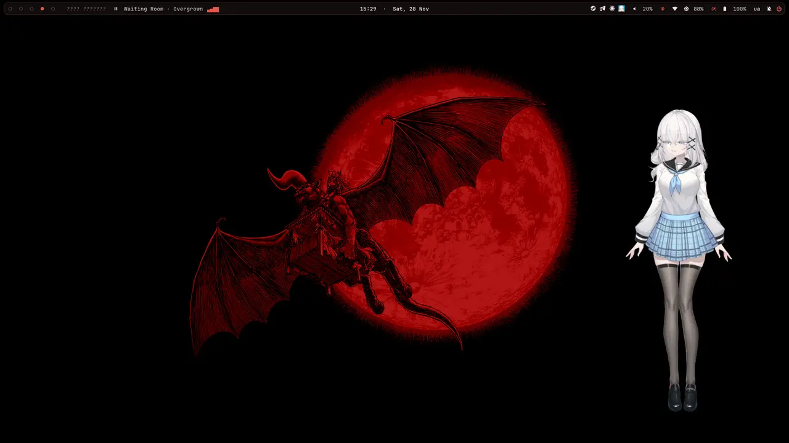
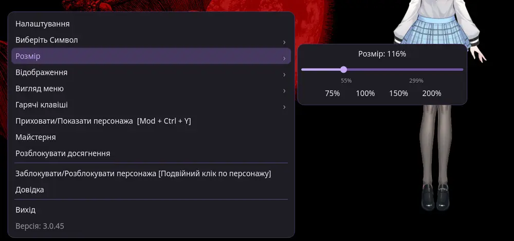

# yourwife-linux-niri

Make **Your Wife** (Steam app 3339420, a Live2D anime desktop companion for Windows) run on **Linux + [niri](https://github.com/YaLTeR/niri) (Wayland)** almost exactly like it does on Windows.

[Українською](README.md)



## What you get

- **Real transparency**: no black or magenta box around the character, including semi-transparent parts of the models.
- **She follows you across niri workspaces.** Double-click her to pin her to the current workspace instead.
- **Her eyes follow the cursor over the whole screen.**
- **The game's right-click menu works**: it opens instantly, stays on screen and closes when you click outside it, even on an empty desktop. The menu is reworked: size slider, emotions, a menu theme (light/dark/black and two accent colours) and hotkeys.
- **Tray icon in waybar** (or any StatusNotifierItem tray), replacing the Wine tray that doesn't work on Wayland:
  - left click opens the game menu;
  - right click shows hide/show, lock, settings, Workshop, help and quit.
- **Live control from the terminal**: change the character, size, emotions and FPS limit without restarting the game (`yourwife …`).
- **Fast Workshop.** Subscribing or unsubscribing a character updates one card instead of rebuilding ~2300 widgets.
- **Emotions**:
  - any `*.exp3.json` expressions shipped with Workshop models can be mixed freely;
  - they are remembered per character.
- **She stays above fullscreen windows**, like "always on top" on Windows (needs the niri patch).
- **Steam notification toasts** go to the bottom-right corner.




## How it works

| Problem on Linux | Fix |
|---|---|
| Black window (Godot's D3D12 renderer has no swapchain under Proton) | `game/override.cfg` switches the game to Vulkan and hides the Godot boot splash |
| Black background instead of transparency (Wine windows are 24-bit) | Wine registry `X11 Driver\ScreenDepth = "32"` (set by `install.sh`) gives ARGB windows with real alpha |
| Stuck on one niri workspace | `bin/niri-pin` moves her to the active workspace, unless she is locked |
| Eyes don't follow the cursor (Wayland hides it from clients, Wine only updates on X motion) | patched `niri msg cursor-position` + `bin/yw-gaze` sends synthetic X `MotionNotify` events; it slows down from 30 Hz to 4 Hz while the cursor is still |
| Hovering the character opens Steam menus (all X windows in xwayland-satellite sit at 0,0) | the game gets its own X server: `xwayland-satellite :2` + Steam launch option `DISPLAY=:2 %command%` |
| The game can't resize its own window under niri, so you get cut-off parts and stripes | the game reports the size it wants, `yw-gaze` applies width, height and offset in one niri request, and `no-resize-animation` (patch) turns off niri's resize animation for it |
| The game menu took 2–20 s to open (it creates a `SystemFont` per row, which is slow under Wine) | `game/linux_key.gd` swaps the menu window's script for `game/linux_menu.gd`: one window, same items and actions, ~10 ms |
| Clicking outside the menu doesn't close it | `niri-pin` closes it when focus moves to another window; `yw-menu-catcher` adds an invisible layer under the windows that catches clicks on the empty desktop |
| The Wine tray doesn't work | `bin/yw-tray` provides a StatusNotifierItem with the same actions; its icon is extracted from `YourWife.exe` at install time |
| Floating windows hide under a fullscreen window, and other floating windows (Mod+G) cover her | `above-fullscreen` window rule (patch): she stays visible and clickable above fullscreen windows and above other floating windows; the game's own windows (menu, settings) keep their usual order |
| Clicking her made her the focused window, so Mod+F, Mod+M etc. acted on her | `no-focus` rule (patch) + `on-xdg-activate "ignore"`: clicks and scrolls reach the game, but focus stays on your window |
| At startup her window sometimes stayed screen-sized and, though transparent, blocked clicks | `linux_key.gd` re-applies her size 3 and 8 s after start |
| Workshop freezes | `game/linux_workshop_window.gd` reuses unchanged cards, merges rebuilds, skips work while hidden and loads small preview images from the Steam CDN |

## Requirements

- niri. It works on **stock niri**. Building niri with `patches/niri-yourwife.patch` adds:
  - cursor gaze;
  - smooth resizing;
  - staying above fullscreen windows.
- `xwayland-satellite`, `python-gobject`, `gtk4-layer-shell`, `libxtst`, `imagemagick`, `noto-fonts-cjk`
- Steam + Proton (tested with Proton Experimental 11)

## Install

**As an Arch package**: the PKGBUILD is in [`packaging/aur`](packaging/aur). AUR registration is closed for now, so build it yourself:
```bash
git clone https://github.com/fort1sss/yourwife-linux-niri && cd yourwife-linux-niri/packaging/aur && makepkg -si
yourwife-setup
```

**From git:**
```bash
git clone https://github.com/fort1sss/yourwife-linux-niri && cd yourwife-linux-niri
./install.sh
```
`install.sh`:
- copies the scripts to `~/.local/bin` and the niri rules to `~/.config/niri/yourwife.kdl` (adding an `include`);
- installs the game scripts and sets the Wine registry keys;
- extracts the tray icon.

If your niri doesn't have the patch, it drops the rules that need it.

Then:
1. Steam → Your Wife → Properties:
   - set **Launch options** to `DISPLAY=:2 %command%`;
   - turn the **Steam overlay** off.
2. Log out of niri and back in.

**Optional, for all features: build niri with the patch.** The patch is made against [niri-shaders](https://github.com/Sileyesi/niri-shaders), a niri fork with per-window shaders.
```bash
git clone https://github.com/Sileyesi/niri-shaders && cd niri-shaders
git apply /path/to/yourwife-linux-niri/patches/niri-yourwife.patch
cargo build --release
sudo install -Dm755 -s target/release/niri /usr/local/bin/niri
```

## The `yourwife` command

While the game is running, commands apply instantly: `linux_key.gd` inside the game reads them from a file. When the game is closed, they edit its settings.

```text
yourwife list                 all characters: 8 built-in + Workshop
yourwife char 1..8|ID|name    switch character
yourwife size 0.55..4.5       size (capped so the window is at most 2 screens tall)
yourwife top on|off           always on top
yourwife togglehide           hide/show (default hotkey Mod+Ctrl+Y)
yourwife togglelock           pin to the current workspace / unpin (also: double-click her)
yourwife theme light|dark|black [MAIN SECOND]   menu look (colours 0..7)
yourwife emotions | expr NAME|off | motion GROUP [N]
yourwife fps 30|60            frame limit (30 ≈ half the CPU)
yourwife menu|settings|workshop|help
yourwife autostart on|off     start with the session
yourwife start|stop|restart|status
```

## Limitations

- The game's wallpaper mode doesn't work (on niri the wallpaper is drawn by swaybg/swww).
- Steam/Proton API calls still cause short pauses in the Workshop.

## License

- Scripts and configs: MIT.
- `patches/niri-yourwife.patch` modifies niri and is GPL-3.0-or-later.
- Your Wife belongs to its developer (HaHaHaGame). This repository contains no game files; the tray icon is extracted from your own copy of the game.
